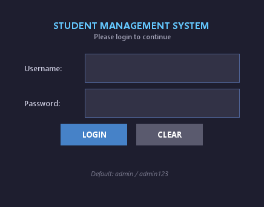
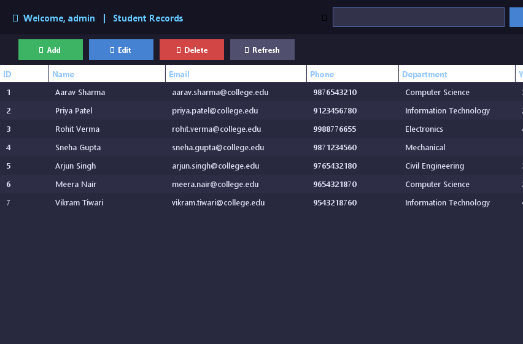
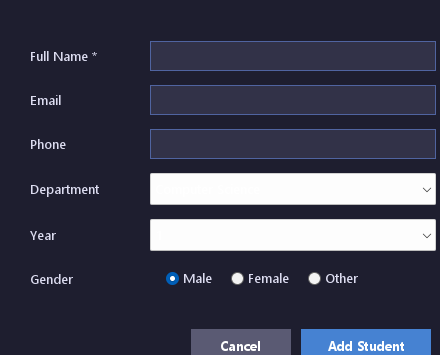

# JAVA ASSESSMENT - 4: PROJECT DOCUMENTATION

**Course**: Java Programming (Module-5: GUI & JDBC Architecture)  
**Project Title**: Student Management System (SMS) Desktop Application  
**Repository**: https://github.com/yuvacharanveesam-ops/StudentManagementSystem  

---

## 1. Introduction
The **Student Management System (SMS)** is a graphical desktop application developed to facilitate the recording, updating, retrieving, and deletion of student administrative data within educational organizations. Manual and spreadsheet-based systems are prone to record redundancy, inconsistency, and lack of real-time multi-field search capabilities. 

This application was engineered using **Java Swing and AWT** for the graphical user interface and **Java Database Connectivity (JDBC)** for persistent transactional storage with MySQL. It embodies key object-oriented design patterns, particularly the **Data Access Object (DAO)** pattern, and provides automated fallback to an in-memory repository to guarantee fault tolerance and high availability.

---

## 2. Application Details

### 2.1 Purpose
The purpose of the application is to offer academic staff and administrators a lightweight, secure, and user-friendly desktop dashboard to maintain student demographic and enrollment records.

### 2.2 Key Features
- **User Authentication**: Secure login window with masked credential input (`JPasswordField`).
- **Student Data Operations (CRUD)**:
  - **Create**: Add new student details with validation (name, email, phone, department, year, gender).
  - **Read**: Interactive `JTable` rendering all enrolled students with responsive column sizing and scrolling.
  - **Update**: Edit existing student records with pre-populated input dialogs.
  - **Delete**: Remove student entries with confirmation prompts (`JOptionPane`).
- **Real-Time Filtering & Search**: Instant filtering of records by name, email, or department.
- **Dual Persistence / High Availability**: Seamlessly persists data to a local or remote MySQL database. When the database is offline or during demonstrations, it automatically switches to an in-memory repository without throwing unhandled exceptions.
- **Automated Test Suite**: Full unit test coverage using JUnit 5.

### 2.3 Working Workflow
1. **Startup**: `Main.java` initializes the native system Look-and-Feel and checks database connectivity using `DBConnection.testConnection()`.
2. **Login**: `LoginFrame` is dispatched on the Event Dispatch Thread (`SwingUtilities.invokeLater()`). The user enters credentials (`admin` / `admin123`).
3. **Authentication**: `StudentDAO.validateUser()` queries the database or verifies credentials against demo data.
4. **Dashboard View**: Upon successful authentication, `LoginFrame` is disposed and `DashboardFrame` opens, loading all student records into a custom table model.
5. **Record Operations**:
   - Clicking **Add Student** opens `StudentFormDialog` in creation mode.
   - Selecting a row and clicking **Edit Student** loads the student's attributes into `StudentFormDialog`.
   - Clicking **Delete Student** triggers an alert confirmation before calling `StudentDAO.deleteStudent()`.
   - Entering text in the search bar and clicking **Search** filters records dynamically using SQL `LIKE` queries or in-memory pattern matching.

---

## 3. Technologies & Module-5 Concepts Applied

### 3.1 Pure Java AWT Implementation Matrix (Exact Module-5 Syllabus Mapping)
The application includes a pure AWT desktop version (`AwtStudentApp.java`) implementing every component from the Module-5 syllabus:

| Syllabus Component | AWT Class Used | Implementation in Project |
| :--- | :--- | :--- |
| **Top-Level Container** | `java.awt.Frame` | Base class for `AwtStudentApp` (`extends Frame`) with title, menu bar, and window sizing. |
| **Intermediate Containers**| `java.awt.Panel` | Multiple panels organizing sections (`northPanel`, `formGrid`, `searchPanel`, `buttonBar`). |
| **Modal / Non-Modal Dialog** | `java.awt.Dialog` | Modal confirmation & alert popups (`new Dialog(this, "Message", true)`). |
| **Labels** | `java.awt.Label` | Form field descriptions and header titles (`new Label("Full Name:")`). |
| **Single-Line Text Input** | `java.awt.TextField` | Input fields for ID, Name, Email, Phone, and Search (`new TextField(20)`). |
| **Multi-Line Text Display**| `java.awt.TextArea` | Multi-line scrollable output display for records (`new TextArea(20, 50)`). |
| **Buttons** | `java.awt.Button` | Action triggers: `Add Student`, `Update`, `Delete`, `Search`, `Clear Form`. |
| **Drop-Down List** | `java.awt.Choice` | Dropdown selection for Department (`CSE`, `IT`, `ECE`, etc.) and Academic Year. |
| **Radio Button Behavior** | `java.awt.CheckboxGroup` & `Checkbox` | Mutual exclusive gender selection (`new CheckboxGroup()`, `new Checkbox("Male", cg, true)`). |
| **Menu System** | `MenuBar`, `Menu`, `MenuItem` | Top application menu bar with `File` (Refresh, Exit) and `Help` (About). |
| **Layout Managers** | `BorderLayout`, `GridLayout`, `FlowLayout` | Complex responsive layout nesting: Form in `GridLayout(7,2)`, toolbar in `FlowLayout`, window in `BorderLayout`. |
| **Event Handling** | `ActionListener`, `WindowAdapter` | `actionPerformed(ActionEvent e)` handling button actions; `windowClosing(WindowEvent e)` for clean exit. |

### 3.2 JDBC Architecture & Enterprise Patterns
| JDBC / Architecture Concept | Implementation in Code |
| :--- | :--- |
| **JDBC Driver** | `com.mysql.cj.jdbc.Driver` loaded dynamically. |
| **Connection Pooling & Manager** | Centralized `DBConnection.getConnection()` using `DriverManager`. |
| **PreparedStatement (Anti-SQLi)**| Parameterized SQL queries preventing SQL Injection across all CRUD operations. |
| **DAO Pattern** | `StudentDAO.java` encapsulates all persistence logic with automatic in-memory fallback. |

---

## 4. Application Screenshots

### Screen 1: Login Window
*The entry screen providing masked authentication for administrative staff.*  


### Screen 2: Student Management Dashboard
*The central workspace displaying the student record table, search bar, and action controls.*  


### Screen 3: Add / Edit Student Dialog
*Modal dialog for creating and modifying student records with field validation.*  


---

## 5. Source Code

### 5.1 Main Entry Point (`Main.java`)
```java
package com.studentmanagement.desktop;

import com.studentmanagement.util.DBConnection;
import javax.swing.*;

public class Main {
    public static void main(String[] args) {
        try {
            UIManager.setLookAndFeel(UIManager.getSystemLookAndFeelClassName());
        } catch (Exception e) {
            System.err.println("[Main] Could not set system L&F: " + e.getMessage());
        }

        boolean dbConnected = DBConnection.testConnection();
        if (!dbConnected) {
            System.out.println("[Main] MySQL not connected. Running in Demo / Offline Mode with sample data.");
        }

        SwingUtilities.invokeLater(() -> {
            LoginFrame loginFrame = new LoginFrame();
            loginFrame.setVisible(true);
        });
    }
}
```

### 5.2 Model (`Student.java`)
```java
package com.studentmanagement.model;

public class Student {
    private int id;
    private String name;
    private String email;
    private String phone;
    private String department;
    private int year;
    private String gender;

    public Student() {}

    public Student(int id, String name, String email, String phone, String department, int year, String gender) {
        this.id = id;
        this.name = name;
        this.email = email;
        this.phone = phone;
        this.department = department;
        this.year = year;
        this.gender = gender;
    }

    public Student(String name, String email, String phone, String department, int year, String gender) {
        this(0, name, email, phone, department, year, gender);
    }

    public int getId() { return id; }
    public void setId(int id) { this.id = id; }
    public String getName() { return name; }
    public void setName(String name) { this.name = name; }
    public String getEmail() { return email; }
    public void setEmail(String email) { this.email = email; }
    public String getPhone() { return phone; }
    public void setPhone(String phone) { this.phone = phone; }
    public String getDepartment() { return department; }
    public void setDepartment(String department) { this.department = department; }
    public int getYear() { return year; }
    public void setYear(int year) { this.year = year; }
    public String getGender() { return gender; }
    public void setGender(String gender) { this.gender = gender; }
}
```

### 5.3 Database Connection Utility (`DBConnection.java`)
```java
package com.studentmanagement.util;

import java.sql.Connection;
import java.sql.DriverManager;
import java.sql.SQLException;

public class DBConnection {
    private static final String DB_URL = "jdbc:mysql://localhost:3306/student_management?useSSL=false&allowPublicKeyRetrieval=true&serverTimezone=UTC";
    private static final String DB_USER = "root";
    private static final String DB_PASSWORD = "root";
    private static final String DRIVER_CLASS = "com.mysql.cj.jdbc.Driver";

    static {
        try {
            Class.forName(DRIVER_CLASS);
        } catch (ClassNotFoundException e) {
            throw new RuntimeException("MySQL JDBC Driver not found", e);
        }
    }

    public static Connection getConnection() throws SQLException {
        return DriverManager.getConnection(DB_URL, DB_USER, DB_PASSWORD);
    }

    public static boolean testConnection() {
        try (Connection con = getConnection()) {
            return con != null && !con.isClosed();
        } catch (SQLException e) {
            System.err.println("[DBConnection] Connection test failed: " + e.getMessage());
            return false;
        }
    }
}
```

### 5.4 Database Access Object (`StudentDAO.java`)
```java
package com.studentmanagement.dao;

import com.studentmanagement.model.Student;
import com.studentmanagement.util.DBConnection;
import java.sql.*;
import java.util.ArrayList;
import java.util.List;
import java.util.concurrent.atomic.AtomicInteger;

public class StudentDAO {
    private static final String INSERT_SQL = "INSERT INTO students (name, email, phone, department, year, gender) VALUES (?, ?, ?, ?, ?, ?)";
    private static final String SELECT_ALL_SQL = "SELECT * FROM students ORDER BY id";
    private static final String SELECT_BY_ID_SQL = "SELECT * FROM students WHERE id = ?";
    private static final String SEARCH_SQL = "SELECT * FROM students WHERE name LIKE ? OR email LIKE ? OR department LIKE ?";
    private static final String UPDATE_SQL = "UPDATE students SET name=?, email=?, phone=?, department=?, year=?, gender=? WHERE id=?";
    private static final String DELETE_SQL = "DELETE FROM students WHERE id = ?";
    private static final String VALIDATE_USER_SQL = "SELECT * FROM users WHERE username = ? AND password = ?";

    private static final List<Student> IN_MEMORY_STUDENTS = new ArrayList<>();
    private static final AtomicInteger ID_COUNTER = new AtomicInteger(100);

    static {
        IN_MEMORY_STUDENTS.add(new Student(1, "Aarav Sharma", "aarav.sharma@college.edu", "9876543210", "Computer Science", 3, "Male"));
        IN_MEMORY_STUDENTS.add(new Student(2, "Priya Patel", "priya.patel@college.edu", "9123456780", "Information Technology", 2, "Female"));
        IN_MEMORY_STUDENTS.add(new Student(3, "Rohit Verma", "rohit.verma@college.edu", "9988776655", "Electronics", 4, "Male"));
        IN_MEMORY_STUDENTS.add(new Student(4, "Sneha Gupta", "sneha.gupta@college.edu", "9871234560", "Mechanical", 1, "Female"));
    }

    public boolean addStudent(Student student) {
        if (!DBConnection.testConnection()) {
            student.setId(ID_COUNTER.incrementAndGet());
            return IN_MEMORY_STUDENTS.add(student);
        }
        try (Connection con = DBConnection.getConnection();
             PreparedStatement ps = con.prepareStatement(INSERT_SQL, Statement.RETURN_GENERATED_KEYS)) {
            ps.setString(1, student.getName());
            ps.setString(2, student.getEmail());
            ps.setString(3, student.getPhone());
            ps.setString(4, student.getDepartment());
            ps.setInt(5, student.getYear());
            ps.setString(6, student.getGender());
            int affected = ps.executeUpdate();
            if (affected > 0) {
                try (ResultSet rs = ps.getGeneratedKeys()) {
                    if (rs.next()) student.setId(rs.getInt(1));
                }
                return true;
            }
            return false;
        } catch (SQLException e) {
            return false;
        }
    }

    public List<Student> getAllStudents() {
        if (!DBConnection.testConnection()) {
            return new ArrayList<>(IN_MEMORY_STUDENTS);
        }
        List<Student> list = new ArrayList<>();
        try (Connection con = DBConnection.getConnection();
             PreparedStatement ps = con.prepareStatement(SELECT_ALL_SQL);
             ResultSet rs = ps.executeQuery()) {
            while (rs.next()) list.add(mapRow(rs));
        } catch (SQLException e) {
            return new ArrayList<>(IN_MEMORY_STUDENTS);
        }
        return list;
    }

    public List<Student> searchStudents(String keyword) {
        if (!DBConnection.testConnection()) {
            String lower = keyword.toLowerCase();
            List<Student> results = new ArrayList<>();
            for (Student s : IN_MEMORY_STUDENTS) {
                if (s.getName().toLowerCase().contains(lower) ||
                    s.getEmail().toLowerCase().contains(lower) ||
                    s.getDepartment().toLowerCase().contains(lower)) {
                    results.add(s);
                }
            }
            return results;
        }
        List<Student> list = new ArrayList<>();
        try (Connection con = DBConnection.getConnection();
             PreparedStatement ps = con.prepareStatement(SEARCH_SQL)) {
            String pattern = "%" + keyword + "%";
            ps.setString(1, pattern);
            ps.setString(2, pattern);
            ps.setString(3, pattern);
            try (ResultSet rs = ps.executeQuery()) {
                while (rs.next()) list.add(mapRow(rs));
            }
        } catch (SQLException e) {
            return new ArrayList<>();
        }
        return list;
    }

    public boolean updateStudent(Student student) {
        if (!DBConnection.testConnection()) {
            for (int i = 0; i < IN_MEMORY_STUDENTS.size(); i++) {
                if (IN_MEMORY_STUDENTS.get(i).getId() == student.getId()) {
                    IN_MEMORY_STUDENTS.set(i, student);
                    return true;
                }
            }
            return false;
        }
        try (Connection con = DBConnection.getConnection();
             PreparedStatement ps = con.prepareStatement(UPDATE_SQL)) {
            ps.setString(1, student.getName());
            ps.setString(2, student.getEmail());
            ps.setString(3, student.getPhone());
            ps.setString(4, student.getDepartment());
            ps.setInt(5, student.getYear());
            ps.setString(6, student.getGender());
            ps.setInt(7, student.getId());
            return ps.executeUpdate() > 0;
        } catch (SQLException e) {
            return false;
        }
    }

    public boolean deleteStudent(int id) {
        if (!DBConnection.testConnection()) {
            return IN_MEMORY_STUDENTS.removeIf(s -> s.getId() == id);
        }
        try (Connection con = DBConnection.getConnection();
             PreparedStatement ps = con.prepareStatement(DELETE_SQL)) {
            ps.setInt(1, id);
            return ps.executeUpdate() > 0;
        } catch (SQLException e) {
            return IN_MEMORY_STUDENTS.removeIf(s -> s.getId() == id);
        }
    }

    public boolean validateUser(String username, String password) {
        if (!DBConnection.testConnection()) {
            return "admin".equalsIgnoreCase(username) && "admin123".equals(password);
        }
        try (Connection con = DBConnection.getConnection();
             PreparedStatement ps = con.prepareStatement(VALIDATE_USER_SQL)) {
            ps.setString(1, username);
            ps.setString(2, password);
            try (ResultSet rs = ps.executeQuery()) {
                return rs.next();
            }
        } catch (SQLException e) {
            return "admin".equalsIgnoreCase(username) && "admin123".equals(password);
        }
    }

    private Student mapRow(ResultSet rs) throws SQLException {
        return new Student(
            rs.getInt("id"),
            rs.getString("name"),
            rs.getString("email"),
            rs.getString("phone"),
            rs.getString("department"),
            rs.getInt("year"),
            rs.getString("gender")
        );
    }
}
```

---

## 6. GitHub Repository Link
```
https://github.com/yuvacharanveesam-ops/StudentManagementSystem
```
